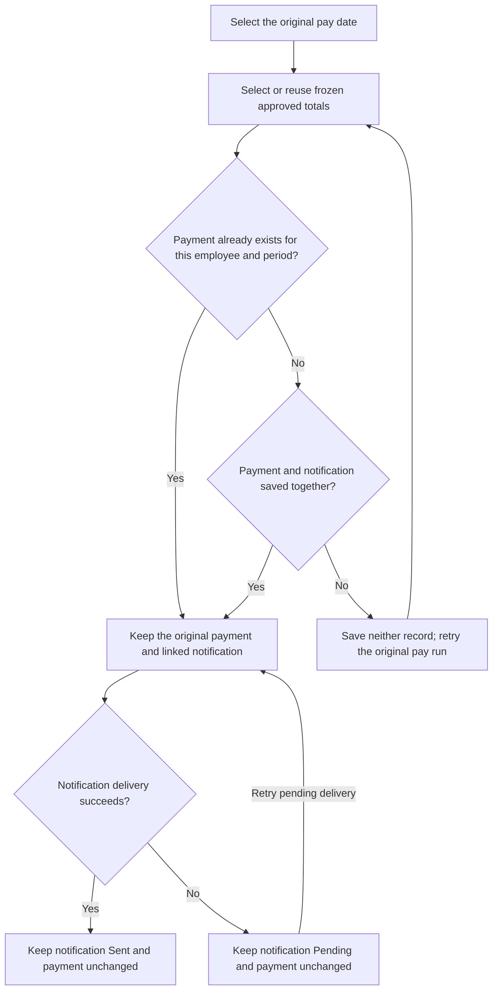

# Business rules: approved earnings, payment and recovery

MustPayroll records employee earnings, lets an operator approve or reject them, and combines approved earnings into weekly payments. Each payment must have exactly one linked notification telling the employee about that payment.

The application uses synthetic data. **Paid** means a payment was saved in the local database; **Sent** means simulated notification delivery succeeded. No real funds move or external messages are sent. Each build keeps its own employee, earning, payment and notification records.

## Two builds, one business rule

MUST Company's Quest assessment requires the selected regression check to fail against faulty behavior and pass after correction. MustPayroll keeps both versions available so a reviewer can reproduce the failure and verify the correction independently.

| Build | Application | Browser address | Role in the comparison |
|---|---|---|---|
| Buggy | [MustPayroll_buggy](../../MustPayroll/MustPayroll_buggy) | [localhost:4175](http://127.0.0.1:4175/overview) | Preserves the three controlled defects listed below |
| Fixed | [MustPayroll_fixed](../../MustPayroll/MustPayroll_fixed) | [localhost:4176](http://127.0.0.1:4176/overview) | Applies the corrections to the same payroll flow |

Each application has its own compiled interface, server, payment policy, build tools and database. Its policy is fixed to that build. Processing or resetting a pay week in one leaves the other build's records unchanged. Verification is organized in separate [buggy quality control](../Quality%20Control/Buggy%20build) and [fixed quality control](../Quality%20Control/Fixed%20build) folders. Each contains its own browser execution project, API collection and results.

The comparison uses equivalent employees, earnings, approvals, pay dates and failure conditions prepared separately in each build. The eight cases and expected business outcomes remain the same. Generated record IDs can differ between builds; retry must preserve the original payment identity within the build being tested.

The following sections define the required behavior for both versions. The fixed build implements it; the controlled-defect table then shows where the buggy build diverges.

## Pay period and eligibility

Each pay run is identified by its Tuesday pay date at 09:00 Coordinated Universal Time (UTC). It pays for the preceding completed week: Monday at 00:00 UTC up to the following Monday at 00:00 UTC. The opening instant is included; the closing instant belongs to the next period.

For the 13 October 2026 pay run:

| Boundary | Timestamp | Treatment |
|---|---|---|
| Opening | 5 October 2026, 00:00 UTC | Include earnings at this instant |
| Closing | 12 October 2026, 00:00 UTC | Exclude earnings at this instant; include them in the next period |
| Pay date | 13 October 2026, 09:00 UTC | Keep this pay date when retrying the run |

An earning's date determines its period. Timestamps must include `Z` or an explicit timezone offset and are converted to UTC before selection. For example, 5 October at 00:30 +01:00 becomes 4 October at 23:30 UTC and is outside this period.

Only **Approved** earnings contribute to pay. **Pending** and **Rejected** earnings remain unpaid without blocking approved earnings in the same period. If no approved earnings qualify, the fixed build creates neither a pay run nor a payment.

Before processing, an operator can approve or reject a Pending earning. Rejection requires confirmation; cancelling leaves it Pending. A decision retains the earning ID and records an audit event. Approved and Rejected decisions cannot be changed; repeating the same decision adds no event.

## Amounts and duplicate input

Amounts are in US dollars (USD or $). The application stores whole cents: `amountCents: 150000` means $1,500.00. Approved amounts are added together per employee; the model calculates no tax or deductions.

Each earning has a permanent ID. Importing the same ID with identical data leaves one record. Reusing it with conflicting data is rejected. Repeated imports must not increase pay.

## Processing and period locking

The first valid processing request saves the selected earning IDs and each employee's approved total. These are the **frozen totals**: retries reuse them instead of recalculating or adding later earnings. Processing locks the period against new earnings and approval changes.

After processing, a late correction requires an approved adjustment in a later open period, referencing the original earning. Pending records are not automatically approved or carried forward.

## Payment and notification recovery

Within the loaded payroll records, each employee must receive one payment per pay period. The fixed build checks this combination before creating a payment; a database uniqueness constraint reinforces the rule.

For a new payment, the application saves the payment and its linked notification record together in one database transaction: both are saved, or neither is saved. This saved delivery instruction is the **notification work**, also called the **outbox**. Delivery is attempted only after the payment is saved successfully. A failed payment creates no notification.

If delivery succeeds, the notification becomes Sent. If delivery fails, it remains Pending and the payment stays Paid. Retrying payroll must preserve the complete payment record, including its reference, amount and destination, and the linked notification identity. It can recover pending delivery or record an employee's unpaid amount, without paying an already-paid employee again.

**Retry pending notifications** processes existing Pending records. It cannot recreate a notification that was never saved. A payment without notification work therefore requires repair while preserving the payment; another payout is not a recovery action.

## Controlled defects and their checks

A controlled defect is a deliberate implementation change that produces a reproducible violation of a business rule. The buggy build contains three; the fixed build corrects the same three. TC identifies the test case checking each outcome.

| Controlled defect | Buggy behavior | Fixed behavior | Check and report |
|---|---|---|---|
| PAY-001 — duplicate payment on payroll retry | Repeating a $1,500 pay run creates a second payment; recorded pay becomes $3,000 | One $1,500 payment remains with its original reference, amount and destination | TC07 · [Duplicate payment on retry](../Quality%20Control/bug_report/UI%20functional%20bug%20reports/duplicate-payment-on-pay-run-retry-functional.md) |
| PAY-002 — payment without approval | The comparison data produces $5,100 of payments against $4,350 approved because Pending and Rejected earnings are included | Only approved, current-period earnings are paid; the total is $4,350 | TC01 · [Unapproved earnings paid](../Quality%20Control/bug_report/UI%20functional%20bug%20reports/unapproved-earnings-paid-functional.md) |
| PAY-003 — payment without notification work | A $1,500 payment is saved without a linked notification record | Payment and notification work are saved together; delivery produces Sent, or Pending if delivery fails | TC08 for normal delivery and TC06 for delivery failure · [Payment without notification](../Quality%20Control/bug_report/UI%20functional%20bug%20reports/payment-saved-without-notification-functional.md) |

The selected investigation follows **PAY-003 → PAY-001**. First, payment succeeds without its notification instruction. The buggy completion check looks for a Sent notification instead of the saved payment. Because that notification is absent, retry treats the employee as unpaid and pays again. This sequence needs no internet disconnection or configured service failure.

TC06 also exposes PAY-003: it expects payment to survive a delivery failure with a Pending notification, but the buggy build never creates the instruction needed to attempt delivery. TC08 expects a Sent notification after normal processing and finds the same missing record. These are two failed cases for one defect. Together with TC01 and TC07, they explain four failures from three defects.

PAY-002 is an additional approval check alongside the deeper duplicate-payment investigation. The [risk comparison](intent.md#risk-comparison) explains why that investigation takes priority. The [bug report index](../Quality%20Control/bug_report/README.md) links separate functional and API reports; the API reproductions confirm these same defects without adding cases to the eight-case suite.

## Account, administration and operating assumptions

Both applications initially load three example employees. More can be added using a name, role, department, bank and four-digit account ending. The eight-case suite keeps the original employees unchanged. Each payment retains the destination used when it was recorded. Bank-detail editing, inactive employees, permissions and administrator overrides are outside scope; currency and period policy are fixed.

The operator can record earnings and select any past or future Tuesday. **Pay on Tuesday 09:00 UTC** simulates processing at that selected due time, so the workstation date does not block the flow. The request's `scheduledPayRunAt` identifies the pay date; `simulatedProcessingAt` must match it. A missing or different simulated instant is rejected before processing. The audit event records both values; recorded-at timestamps retain the actual execution time. There is no background scheduler or workstation-clock change.

To repeat a local cycle, **Settings → Reset selected pay week** removes that week's earnings, payments, notifications, saved delivery receipts and pay run together. Employees, other weeks and existing audit history remain, and a reset event is added. This reopens the local test week. Corrections without a reset use a later open period.

Both applications run on localhost without authentication, using SQLite in one Node.js process. Restart recovery, concurrent processing, real banking and external delivery durability are outside the verified scope.

## Verification and release decision

The same eight cases apply to both builds: six browser journeys automated with Playwright's Page Object Model (POM), which groups browser actions by application page, and two application programming interface (API) cases. The API cases check service requests and responses and can be repeated in Postman.

The [buggy UI suite](../Quality%20Control/Buggy%20build/Functional%20testing/functional-test-suite.md) and [fixed UI suite](../Quality%20Control/Fixed%20build/Functional%20testing/functional-test-suite.md) define the same six browser cases. The [buggy API suite](../Quality%20Control/Buggy%20build/API%20testing/api-test-suite.md) and [fixed API suite](../Quality%20Control/Fixed%20build/API%20testing/api-test-suite.md) define the same two API cases. Together they cover calculation, period boundaries, timezone conversion, duplicate input, payment failure, notification failure and retry. Each case is judged against its own rule. The [release checklist](release_readiness.md) connects the recorded outcomes to the release decision; the [directive](../directive.md#resultshandoff-appendix) provides the evidence links and recovery handoff.
