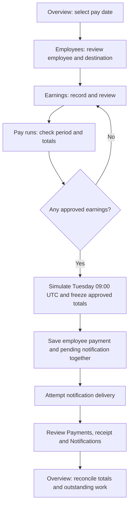

# User flows

MustPayroll connects employee earnings to weekly payment and notification records. The normal journey describes required behavior, implemented by the fixed build. The controlled comparison later shows how the buggy build departs from it. Separate applications keep the faulty and corrected behavior independently reproducible; the [build guide](README.md#expected-behaviour-and-the-two-builds) identifies both.

Use the [startup instructions](../README.md#run-the-applications) to open the intended application. Amounts are USD and earning times are UTC; payment and delivery are local simulations.

## Normal payroll journey

The operator moves between modules to review the same connected records. Payment and initial notification attempts happen during processing; opening their history screens does not trigger them.

1. Open **Overview**. Check the **Pay date** and displayed earning period. On first use, the application loads example employees and approved earnings; review existing records before adding more.
2. Open **Employees**, select the employee and review the bank and masked account ending. Select **Record earnings** to open the form with that employee preselected.
3. Enter description, amount and the time the earning occurred, in UTC. Choose **Pending approval** or **Approved**, then select **Record earnings**. Review pending records for the target period: **Approve earnings** authorizes payment; **Reject earnings** opens confirmation to exclude a claim. Cancel preserves Pending status. Check the resulting Approved or Rejected status before continuing.
4. Open **Pay runs**. Confirm the selected date, earning window, approved total, employee breakdown and recorded pay. Pending and rejected earnings remain unpaid without blocking approved pay in that period.
5. Select **Pay on Tuesday 09:00 UTC**. Check the confirmation details. **Cancel** returns without processing; **Pay on Tuesday 09:00 UTC** in the dialog models the selected due instant without waiting, saves the run and freezes approved totals.
6. The application records each employee payment with pending notification work, then attempts delivery. Check unpaid amounts and notification status separately, then compare the recorded amounts with approved payroll.
7. Open **Payments**, choose **View receipt** and compare reference, amount, period and destination. Open **Notifications** to check delivery status and any error.
8. Return to **Overview** with the original pay date selected. Approved payroll and payments recorded should agree for that period. Pending notifications may include other periods.

For the fresh standard example on 13 October 2026, approved earnings total $4,350: Amara $1,500, Daniel $2,000 and Zara $850. Zara's pending earning dated 12 October belongs to the next period and is excluded from this run.

## Recovery decision

Inspect Payments and Notifications before choosing recovery. A Pending notification is saved delivery work; Not available on a receipt means the linked instruction is absent.

| Observed state | Action | Expected result |
|---|---|---|
| No payment for an eligible employee; run saved | Retry the original pay run | Outstanding payment is recorded once; existing payments remain unchanged. |
| Payment exists; its notification is Pending | Retry pending notifications | The same notification is attempted; payment is unchanged. |
| Duplicate payment or amount mismatch identified by comparing records | Stop the affected period and escalate for reconciliation | The operator retains references and amounts and stops further processing; the application does not enforce this investigative decision. |
| Payment exists but no notification record exists | Retain the payment reference and escalate for repair without another payment | Notification retry cannot recreate missing delivery work. |

### Pending approvals

1. In **Pay runs**, read the pending-approval warning. Pending amounts stay unpaid without blocking approved pay.
2. Follow **Review earnings**. The earning list covers all periods, so inspect timestamps as well as status.
3. Approve records authorized for payment, reject invalid claims using **Reject earnings** and confirm, or leave undecided records pending. Review actions alone record no payment. A processed period locks both actions.
4. Return to **Pay runs** and recheck the approved total before confirming the simulated due-time action. After processing locks the period, late approvals require an approved adjustment in a later open period referencing the original earning.

### Failed payment

1. Inspect **Recorded pay**, **Unpaid amount** and the incomplete-payment warning.
2. Open **Payments** and confirm which employees have saved payments. A failed employee payment has no associated notification.
3. Return to **Pay runs** without changing the date. Select **Retry pay run**, review the dialog and confirm **Retry pay run**.
4. Check that only outstanding employees acquired payments. Previously successful references and amounts must remain unchanged.
5. Review notification status and reconcile Overview. The original run remains locked throughout recovery.

### Successful payment, failed notification

1. Open the receipt and retain the payment reference and amount. A Pending notification does not reverse payment.
2. Open **Notifications** and inspect the delivery error and attempt count.
3. Select **Retry pending notifications**. This retries pending messages across all loaded pay periods, not just the selected one.
4. Inspect the result: successful delivery becomes Sent, increases the attempt count and clears the error; another delivery failure remains Pending. Reopen the receipt and verify the original payment is unchanged.

In the fixed build, **Retry pay run** also preserves payments and attempts pending delivery after handling unpaid employees. Notifications provides the direct action when payment is already complete. The recorded TC06 browser case checks the retained payment and Pending-delivery state; it does not operate the notification-only retry button.

### Payment recorded without notification work

This is a controlled before-and-after demonstration. Prepare equivalent records separately in both applications. For the single-payment example, the selected period contains only Amara's Approved $1,500 earning dated 8 October 2026 at 12:00 UTC, with no payment. Select the 13 October pay date. The [functional duplicate-payment report](../QA/Quality%20Control/bug_report/UI%20functional%20bug%20reports/duplicate-payment-on-pay-run-retry-functional.md) provides the complete browser reproduction.

1. In buggy, select **Pay on Tuesday 09:00 UTC** and confirm once. Payments shows a Paid record, while its receipt shows Notification **Not available**.
2. Open Notifications. No instruction exists for that payment. In this empty-history example, Sent and Pending are zero and **Retry pending notifications** is disabled. TC08 checks this missing instruction.
3. For the controlled retry demonstration, return to the same Pay runs date and confirm **Retry pay run** once. Buggy adds another $1,500 payment. Retain both references and the $3,000 total. TC07 checks the duplicate.
4. In fixed, repeat processing and retry with equivalent starting data. One $1,500 payment and one linked Sent notification remain; their original identities are preserved.

Notification-only retry processes existing Pending work and cannot recreate an absent instruction. The operational response is repair while preserving the payment. The [missing-notification report](../QA/Quality%20Control/bug_report/UI%20functional%20bug%20reports/payment-saved-without-notification-functional.md) documents that separate finding.

### Payment mismatch

1. Compare approved pay with recorded pay and count the payment references for each employee-period. The application shows normal payment statuses without a mismatch warning.
2. Open the relevant receipts and compare their contributing earnings with the approval and uniqueness rules. Retain employee, period, references, amounts and notification states.
3. Escalate for reconciliation. The current application has no reversal, refund or manual reconciliation control.

## Navigation and data scope

Changing the pay date changes the period-specific totals in Overview and Pay runs. It does not hide other periods from Earnings, employee histories, Payments or Notifications. Employee links preselect the earnings form; they do not filter the earning list. The [module guides](README.md#how-the-modules-connect) identify each screen's scope and controls.

## Repeat a local pay week

Add an employee from Employees when needed, then use that person in the earning form. The calendar does not close earning weeks. A processed week stays locked to protect its saved totals; open Settings, select its Tuesday pay date and confirm Reset selected pay week to remove that local cycle and start it again. Employees, other weeks and audit history are kept.

Reset clears the selected local cycle so it can be repeated. It removes the records needed to investigate that cycle. Retain the original defect evidence and use the recovery decision above when investigating an incorrect payment. The [Settings guide](modules/settings.md) lists exactly which records reset removes.
